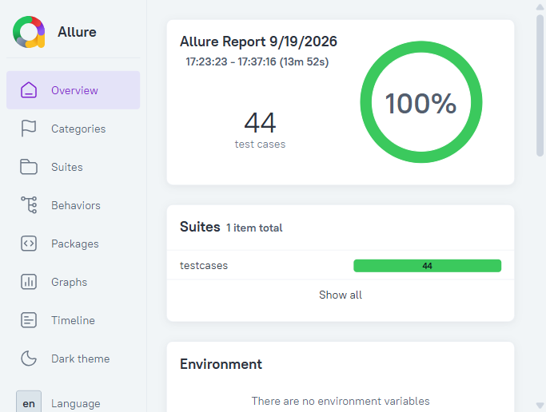
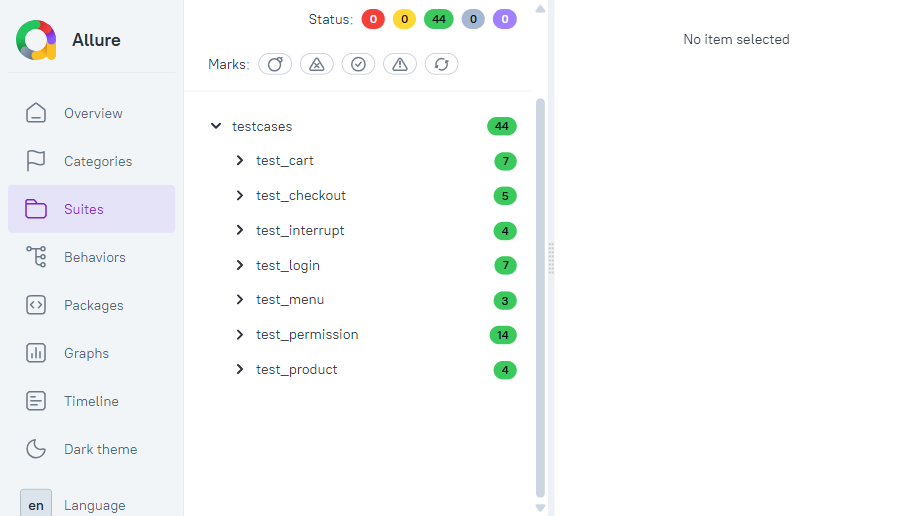
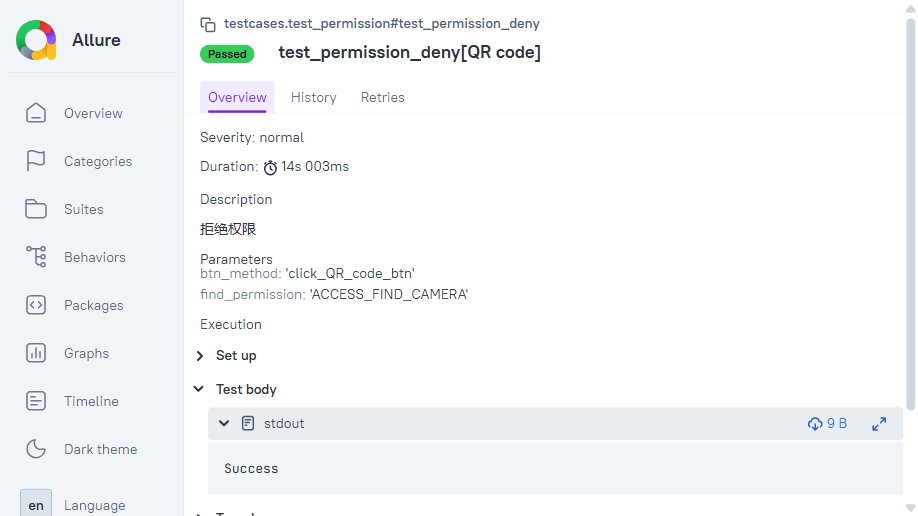

<p align="center">
  <h1 align="center">Sauce Labs Demo App · 移动端自动化测试</h1>
  <p align="center">基于 Appium + pytest + Allure 的 Android App 自动化测试框架（Page Object 模式）</p>
</p>

<p align="center">
  
  
  
  
</p>

> 📊 **在线测试报告**：<https://AAAshanfeng.github.io/swaglabs-mobile-autotest/>　|　本地：双击 `docs/index.html`

---

## 一、项目简介

以 Sauce Labs 官方电商 Demo App（Android，包名 `com.swaglabsmobileapp`）为被测对象，搭建的一套**分层清晰、可维护**的移动端 UI 自动化测试框架。

- **测试范围**：功能测试（登录 / 商品 / 购物车 / 结账 / 侧边菜单）+ 权限测试（定位 / 相机 / 存储）+ 专项测试（中断 / 横竖屏适配 / 兼容性）。
- **用例规模**：约 **44 条**自动化用例（含参数化展开），用例设计文档见 [`test_cases.md`](./test_cases.md)。
- **框架能力**：Page Object 封装、pytest fixture 依赖注入、参数化复用、adb 深度集成校验权限真实状态、显式等待、Allure 报告。

---

## 二、技术栈

| 类别 | 选型 | 版本 |
|---|---|---|
| 移动端自动化 | Appium Python Client + UiAutomator2 | 6.0.6 |
| 测试框架 | pytest | 9.1.1 |
| Web/驱动底座 | Selenium | 4.49.0 |
| 测试报告 | allure-pytest | 2.16.0 |
| 辅助 | adb（权限/包管理/系统命令） | — |
| 运行环境 | Python | 3.12 |

---

## 三、目录结构

```text
.
├── pages/                  # Page Object：每个页面/组件的元素与操作封装
│   ├── base_page.py        # 基类，统一封装显式 WebDriverWait
│   ├── login_page.py
│   ├── product_page.py
│   ├── product_detail_page.py
│   ├── cart_page.py
│   ├── checkout_info_page.py
│   ├── menu_page.py
│   └── permission.py       # 系统权限弹窗 & 画板交互
├── testcases/              # 测试用例（按业务模块拆分）
│   ├── test_login.py
│   ├── test_product.py
│   ├── test_cart.py
│   ├── test_checkout.py
│   ├── test_menu.py
│   ├── test_permission.py  # 参数化 + adb 权限校验
│   └── test_interrupt.py   # 中断 / 横竖屏专项
├── utils/
│   ├── driver.py           # Appium driver 与 capabilities 封装
│   └── device_actions.py   # 设备操作（锁屏/旋转/网络/手势/定位）
├── conftest.py             # pytest fixture：driver / 登录态 / 权限重置 / 失败截图 Hook
├── logging_config.py       # 统一 logging 配置
├── pytest.ini              # pytest 与 Allure 配置
├── requirements.txt        # 依赖
├── test_cases.md           # 测试用例设计文档
└── docs/                   # Allure 单文件在线报告 + README 截图
```

---

## 四、设计要点

- **Page Object 模式**：元素定位与页面操作集中封装到 `pages/`，测试用例主要表达业务流程，降低页面元素变化对测试用例的影响。
- **Fixture 分层复用**：
  - `driver`：负责创建和关闭 Appium Driver。
  - `login_in_driver`：复用 Driver 并完成登录，为需要登录态的用例提供统一前置条件。
  - `reset_permission`：通过 `adb pm clear` 重置 App 权限及数据状态。
- **参数化**：权限模块使用 `@pytest.mark.parametrize` 对定位、相机等权限的通用操作进行复用，减少重复测试代码。
- **ADB 集成验证**：通过 `adb shell dumpsys package`、`pm revoke` 等命令辅助验证权限的实际状态，而不仅仅依赖界面上的权限弹窗。
- **显式等待**：使用 `WebDriverWait` 与 `expected_conditions` 等机制减少固定等待，提高测试稳定性。
- **中断测试**：覆盖锁屏、切后台等 App 中断场景，验证恢复后业务状态是否保持。
- **兼容性验证**：在 Android 10 / 12 / 14 上对登录、购物车、核心结账流程执行兼容性验证，结果见第八节。
- **日志记录**：通过统一的 logging 配置记录关键测试节点，辅助定位测试执行过程。
- **失败自动截图**：通过 pytest `pytest_runtest_makereport` Hook 捕获失败用例，并自动保存失败时的 App 截图。

------

## 五、快速开始

### 1. 环境准备
- 安装 [JDK](https://openjdk.org/)、[Android SDK](https://developer.android.com/studio)（含 `adb`）并配置环境变量
- 安装 Appium：`npm install -g appium`，并装好 `uiautomator2` driver：`appium driver install uiautomator2`
- 启动一个 Android 模拟器或连接真机，`adb devices` 能看到设备
- 安装 Allure 命令行（查看报告用）：`scoop install allure` 或官网下载后配置 PATH

### 2. 安装依赖
```bash
python -m venv .venv
# Windows: .venv\Scripts\activate     macOS/Linux: source .venv/bin/activate
pip install -r requirements.txt
```

### 3. 配置设备 / 驱动
环境相关配置统一通过环境变量注入，代码中不写死本机路径：

| 环境变量 | 用途 | 未设置时的行为 |
|---|---|---|
| `Device_name` | Appium 连接的设备 / 模拟器名 | 默认使用 `emulator-5554` |
| `CHROMEDRIVER_PATH` | WebView 用例所需的 chromedriver 路径 | 不下发该 capability，由 Appium 使用自带版本 |

```powershell
# 仅当前会话生效
$env:Device_name = "emulator-5554"
$env:CHROMEDRIVER_PATH = "C:\path\to\chromedriver.exe"

# 永久生效（用户级）
setx CHROMEDRIVER_PATH "C:\path\to\chromedriver.exe"
```

> - 仅测原生页面可不管 `CHROMEDRIVER_PATH`；侧边菜单的 WebView 用例需要它，且 chromedriver 版本需与设备 WebView / Chrome 主版本匹配。
> - 在 PyCharm 中跑用例时，也可在 Run/Debug Configuration → Environment variables 里配置；用 `setx` 设置后需**完全重启 PyCharm** 才会生效。
> - Appium server 地址默认 `http://127.0.0.1:4723`，如端口不同在 `utils/driver.py` 中调整。

### 4. 运行用例
```bash
appium                                  # 先在一个终端启动 Appium server
pytest                                  # 跑全部（结果自动写入 ./allure-results）
pytest testcases/test_login.py -k success   # 跑单条
```

---

## 六、测试报告

### 本地查看
```bash
pytest                       # 生成 ./allure-results
allure serve ./allure-results   # 浏览器自动打开交互式报告
```

### 报告预览

> 以下截图基于最新一次执行结果（44 条用例全部通过，总时长约 13m 52s）。







### 发布为在线链接
1. 跑用例生成结果：`pytest`
2. 用 `--single-file` 生成**自包含**报告（JS/CSS/数据全部内联进一个 `index.html`）：
   ```bash
   allure generate ./allure-results -o ./docs --clean --single-file
   ```
3. 得到 `docs/index.html`（单文件，本地双击或托管都能打开）
4. 仓库 **Settings → Pages → Source 选 `docs` 文件夹 / 默认分支**
5. 得到 `https://AAAshanfeng.github.io/swaglabs-mobile-autotest/`（即本页顶部的链接）

> ⚠️ Windows PowerShell 若报「禁止运行脚本」（`allure.ps1` 被执行策略拦截），改用 `allure.cmd`，例如：
> `allure.cmd generate ./allure-results -o ./docs --clean --single-file`；或直接在 **cmd.exe** 里运行 `allure`。

### 失败截图

测试失败时，pytest Hook 会自动保存截图：

```text
screenshots/
├── test_xxx_XXXXXXXXXX.png
└── ...
```

截图用于辅助定位 UI 自动化执行过程中的问题。

---

## 七、用例覆盖

| 模块 | 自动化用例数 | 说明 |
|---|---:|---|
| 登录 | 7 | 成功、密码错误、用户不存在、空用户名/密码、锁定账户 |
| 商品浏览 | 4 | 数量、名称/价格排序、详情页展示 |
| 购物车 | 7 | 列表/详情加入、查看、空车、多商品、移除、继续购物 |
| 结账 | 5 | 完整下单、姓/名/邮编为空校验、取消 |
| 侧边菜单 | 3 | 退出登录、重置 App、WebView 跳转 |
| 权限 | 14 | 定位、相机：各 5 种场景（首次请求/允许/拒绝/仅一次/手动撤销）共 10 条，参数化；存储（`READ_MEDIA_IMAGES`）：画板保存 4 种场景 |
| 专项 | 4 | 锁屏中断、切后台中断、商品页/购物车横竖屏适配 |
| **合计** | **44** | 弱网测试（Charles 限速）为手动执行，详见设计文档 |

> 完整用例设计（编号、优先级、前置、步骤、数据、预期）见 [`test_cases.md`](./test_cases.md)。

---

## 八、兼容性测试

针对核心购物流程进行 Android 版本兼容性验证。

### 核心流程

```text
登录
 ↓
商品浏览
 ↓
加入购物车
 ↓
进入结账
 ↓
完成订单
```

### 兼容性测试范围

| 核心用例     | Android 10  | Android 12  | Android 14  |
| ------------ | ----------- | ----------- | ----------- |
| 登录         | Pass | Pass | Pass |
| 购物车       | Pass | Pass | Pass |
| 核心结账流程 | Pass | Pass | Pass |

> 以上结果均为在各 Android 版本环境实际执行所得。
>
> 执行环境：Android 14（API 34，`sdk_gphone64_x86_64`，1080×2400）；Android 10（API 29）、Android 12（API 31）在对应版本模拟器上执行。

------

## 九、执行过程中发现的缺陷

| 编号 | 现象 | 结论 |
|---|---|---|
| menu_008 | About 跳转浏览器后返回 **403** | 目标链接失效/受限，稳定复现，已记录 |
| permission_009 / 010 | 拒绝相机权限后**无友好提示**，再次进入也不再弹权限框 | 用户体验/健壮性缺陷，稳定复现 |
| special_001 / 002 | App 固定竖屏，横屏后不适配 | 属产品设计（锁定方向），转为竖屏健壮性验证 |

> 对于横竖屏问题，需要结合实际产品需求判断是否属于缺陷；本项目重点验证 App 在固定竖屏限制下是否能够保持正常运行。

## 十、亮点小结

- 使用 **Appium + pytest + Page Object Model** 从零搭建移动端 UI 自动化测试框架。

- 按登录、商品、购物车、结账、菜单、权限和专项测试进行模块化组织。
- 使用 `fixture` 管理 Driver 生命周期和登录状态，减少测试用例中的重复代码。
- 使用参数化复用权限相关测试逻辑。
- 使用 **ADB** 辅助验证 Android 权限真实状态，实现 UI 操作与系统状态的结合验证。
- 使用显式等待提升 UI 自动化测试稳定性。
- 覆盖锁屏、切后台、横竖屏、Android 多版本等 App 专项测试场景。
- 接入 **Allure** 生成可视化测试报告。
- 增加 **logging** 记录关键测试执行节点。
- 增加 **失败自动截图**，测试失败后自动保存 App 当前界面，辅助问题定位。
- 对实际测试过程中发现的问题进行记录和分析，而不仅仅关注自动化脚本是否执行成功。

---

## 十一、项目运行结果

项目自动化测试执行完成后，通过 Allure 对测试结果进行统一展示。

测试失败时：

```text
pytest
  ↓
测试失败
  ↓
pytest Hook 捕获失败
  ↓
自动保存 App 截图
  ↓
Allure 展示测试结果
```

通过测试报告、日志和失败截图，可以辅助定位自动化测试执行过程中出现的问题。

------

## 十二、许可与说明

本项目代码以 [MIT License](./LICENSE.md) 开源，主要用于软件测试学习与求职展示。

被测 App 为 Sauce Labs 官方 Demo App。

项目重点展示移动端自动化测试框架设计、测试用例编写、App 专项测试、ADB 辅助验证、测试报告以及测试问题定位能力。
